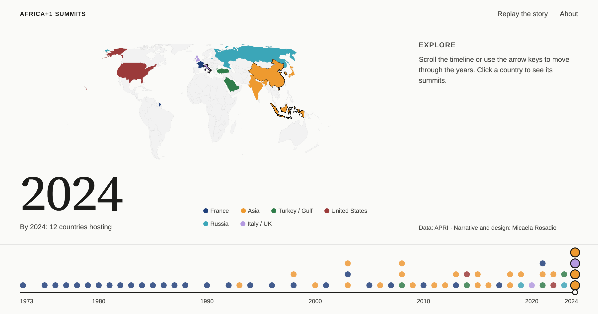

# The Shifting Geography of Africa+1 Summits

An interactive map and timeline of "Africa+1" summits, 1973–2024: how the group of countries hosting summits with African leaders grew from France alone to twelve.

**[View the live visualization](https://mrosadio.github.io/map-africa1-summits/)**



## What it shows

France convened the first Africa+1 summit in 1973 and was the only host until 1993. Japan, China, India, Turkey, the United States, Indonesia, Russia, the United Kingdom, Saudi Arabia, South Korea and Italy followed. The visualization opens with a short story in seven chapters, then lets you explore freely: scrub through the years, or click a country to see all the summits it has hosted.

A country "hosts" a summit when it is the partner country that convenes it. The venue can be elsewhere: 12 of France's 28 summits were held in African cities.

## Features

- **Story mode**: an intro and seven chapters that move the timeline and map to key moments, with a context block from APRI's analysis. Replay or skip at any time.
- **Explore mode**: scroll, drag, tap, or use the arrow keys to move through the years; the map fills in cumulatively and the current year's hosts are outlined.
- **Year card**: stopping on a year opens the summits of that year.
- **Country panel**: click or press Enter on a host country to list all its summits.
- **Responsive**: designed for phone, tablet (portrait and landscape) and desktop. On smaller screens the details move into a panel below the timeline.
- **Accessible**: the timeline is a slider with values, host countries are reachable by keyboard, focus moves into the country panel and back, touch targets are at least 44px, and motion is reduced when the system asks for it.

## Data

Data: [APRI's Africa+1 summit database (Geopolitics and Geoeconomics Program)](https://afripoli.org/africa1-summits-a-closer-look-at-the-geometry-of-global-diplomacy). It covers 1973–2024 and is not exhaustive: for example, it does not include "Africa business summits". APRI states no licence for the data; it is credited here, and it remains APRI's. [Replace with "used with permission from APRI" once you have it in writing.]

Country flags: [svg-country-flags](https://github.com/hampusborgos/country-flags) by Hampus Nilsson, marked public domain (`"license": "PD"` in its `package.json`).

## How it works

- `public/db/summits-by-year.json` holds the summits, `world.geojson` the country shapes.
- `public/db/chapters.json` holds all the text of the intro and the story. Add a chapter by adding an object; the loader checks that its year exists in the data.

```json
{
  "id": "france-1973",
  "type": "data",
  "year": 1973,
  "caption": "France convenes the first Africa+1 summit in Paris…"
}
```
A chapter with `"type": "context"` shows an attributed block (`label`, `text`, optional `link` and `note`) instead of moving the map.

- The page has three modes (`intro`, `story`, `explore`) set on `<body data-mode>`; CSS shows and hides the parts that belong to each.
- All data lives in one `appData` object. `modules/vis/interactions.js` is the only file that knows about both the map and the timeline, which keeps the two independent.

## Project structure

```
├── index.html
├── style.css
├── main.js                        # entry: loads data, starts the visualization
├── vite.config.js
├── public/
│   ├── db/
│   │   ├── summits-by-year.json   # summit dataset
│   │   ├── chapters.json          # intro and story text
│   │   └── world.geojson          # country boundaries
│   ├── src/img/country-flags-main/# flags for the country panel
│   └── social-card.png            # link preview image
├── modules/
│   ├── common/
│   │   ├── globals.js             # shared config and the appData store
│   │   ├── dataLoader.js          # loads and merges the data, validates chapters
│   │   ├── partnerColors.js       # country → region colour
│   │   └── utils.js               # small helpers
│   └── vis/
│       ├── init.js                # starts map, timeline, interactions, story
│       ├── mapUtils.js            # map drawing, country click and keyboard
│       ├── timelineUtils.js       # timeline, scrubbing (wheel, keys, drag), year card
│       ├── interactions.js        # wires the map and the timeline together
│       ├── story.js               # story engine: modes and chapter steps
│       ├── storyView.js           # renders the intro and chapters
│       ├── panel.js               # country panel open/close
│       ├── summitUtils.js         # country panel content
│       ├── stage.js               # switches the stage between time mode and country mode
│       └── tooltip.js             # map tooltip
└── .github/workflows/deploy.yml   # deploys to GitHub Pages on every push to main
```

## Run it locally

```
npm install
npm run dev          # http://localhost:5173/map-africa1-summits/
npm run build        # production build in dist/
npm run preview      # serve the build
```
To test on a phone on the same Wi-Fi: `npm run dev -- --host` and open the `Network:` address it prints.

## Tech

[D3](https://d3js.org/) v7 (bundled, EqualEarth projection, scales and data joins), vanilla JavaScript (ES modules), [Vite](https://vitejs.dev/), [Bootstrap](https://getbootstrap.com/) 5 for the reset and the About modal, and the fonts Arimo and Source Serif 4 through Fontsource.

## Known limitations

- The data ends in 2024.
- Partner countries are grouped into six colour categories rather than one colour each, a deliberate choice for a readable legend. Some of the lighter colours are below the 3:1 contrast ratio against the background; the legend, tooltip and panel name every country so colour is never the only cue.
- The map does not zoom (planned).

## Licence

The code is released under the [MIT licence](LICENSE). The data belongs to APRI (see above).

## Credits

Data: APRI Geopolitics and Geoeconomics Program team.
Narrative, design and development: Micaela Rosadio.